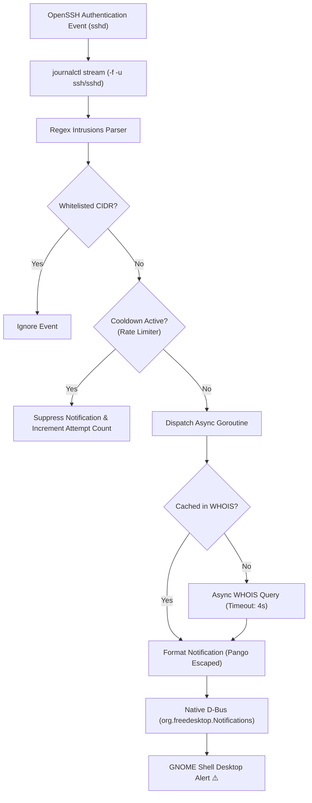

# ssh-watch-gnome (malaip)

[](https://golang.org)
[](https://www.gnome.org/)
[](LICENSE)

A lightweight, real-time background daemon written in Go for Linux desktops (GNOME). It monitors OpenSSH authentication failures via `journalctl`, enriches attacker IPs with geographical and ISP data using asynchronous WHOIS lookups, suppresses notification floods through intelligent rate-limiting, and delivers native desktop notifications directly over D-Bus.

---

## 🎯 Objective & Problem Statement

Running an SSH server on a machine exposed to the local network or the internet makes it a target for constant automated scanning and credential stuffing / brute-force attacks.

On desktop systems (such as Ubuntu Desktop or Debian with GNOME), users typically have **zero visibility** into these attacks unless they manually inspect `journalctl` or log files. Furthermore:
- **Naive alerting scripts spam the desktop:** A brute-force tool generating dozens of attempts per second can crash or freeze notification services with pop-ups.
- **Synchronous WHOIS blocks monitoring:** Querying remote WHOIS servers synchronously causes latency or hung processes if a server is slow or unresponsive.
- **Root requirements create security risks:** Many log monitoring utilities require running with elevated (`sudo` / `root`) privileges.

**`ssh-watch-gnome` solves this** by providing:
1. **Zero-privilege user execution:** Runs in user space (`systemd --user`) using standard journal groups (`adm` / `systemd-journal`).
2. **Instant native alerts:** Communicates directly with GNOME Shell over D-Bus (`org.freedesktop.Notifications`) without spawning external shell processes like `notify-send`.
3. **Flood prevention & Debouncing:** Groups bursts from the same IP, displaying a single alert with an aggregated attempt counter while caching WHOIS lookups.
4. **Asynchronous IP enrichment:** Performs non-blocking WHOIS queries with timeouts and an in-memory TTL cache to show the attacker's country, ISP, and ASN.
5. **CIDR Whitelisting:** Easily filters out internal network ranges, VPNs, or trusted IPs.

---

## 🔍 How It Works



### Notification Preview

When an unauthorized login or password failure occurs, a persistent high-priority notification appears on your GNOME desktop:

```text
⚠️ Intento fallido de SSH
IP: 203.0.113.45 (CN)
Usuario: root
Organización: China Telecom (AS4134)
Intentos detectados: 1
```

---

## ✨ Features

- **Real-Time Streaming:** Subscribes to `journalctl` directly using `CommandContext`; no polling or disk re-reading overhead.
- **Native D-Bus Notifications:** Uses `github.com/godbus/dbus/v5` for direct communication with `org.freedesktop.Notifications` using Critical urgency (`Urgency: 2`).
- **Async WHOIS with TTL Cache:** Thread-safe in-memory cache stores WHOIS lookups for 24 hours (configurable), eliminating redundant network calls.
- **Smart Rate-Limiting:** Suppresses repeat notifications from the same IP within a configurable cooldown period (e.g., 60s) while counting the total burst size.
- **Strict Network Whitelisting:** Supports IPv4 and IPv6 CIDR blocks (e.g., `127.0.0.1/32`, `192.168.1.0/24`, `::1/128`).
- **Pango Markup Sanitization:** Automatically sanitizes input (`html.EscapeString`) to prevent XML/Pango injection issues in GNOME Shell.
- **Minimal Footprint:** Consumes less than 15 MB of RAM and negligible CPU (<0.5%) in idle state.

---

## 📋 Prerequisites

1. **Linux Distribution:** Ubuntu Desktop 22.04+, Debian, Fedora, or any Linux system running GNOME and `systemd`.
2. **Journal Permissions:** Ensure your desktop user belongs to the `adm` or `systemd-journal` group so it can read system logs without `sudo`:
   ```bash
   sudo usermod -aG systemd-journal $USER
   # (Log out and log back in for changes to take effect)
   ```
3. **WHOIS Utility:**
   ```bash
   sudo apt install whois   # Ubuntu / Debian
   # or
   sudo dnf install whois   # Fedora
   ```
4. **Go (for building from source):** Go 1.22 or higher.

---

## 🚀 Installation & Setup

### 1. Clone the Repository
```bash
git clone https://github.com/your-username/malaip.git
cd malaip
```

### 2. Build and Install
Run the automated install script:
```bash
./install.sh
```
Or use `make`:
```bash
make install
```

This will:
- Compile the binary to `bin/ssh-watch-gnome` with stripped symbols (`-ldflags="-s -w"`).
- Copy the binary to `~/.local/bin/ssh-watch-gnome`.
- Install the systemd user service to `~/.config/systemd/user/ssh-watch-gnome.service`.
- Create a default configuration at `~/.config/ssh-watch-gnome/config.json`.

### 3. Enable and Start the User Service
```bash
systemctl --user daemon-reload
systemctl --user enable --now ssh-watch-gnome.service
```

Check the status:
```bash
systemctl --user status ssh-watch-gnome.service
```

---

## ⚙️ Configuration

The configuration file is located at `~/.config/ssh-watch-gnome/config.json`:

```json
{
  "cooldown_seconds": 60,
  "whois_cache_ttl_hours": 24,
  "whois_timeout_seconds": 4,
  "urgency": 2,
  "whitelist_cidrs": [
    "127.0.0.1/32",
    "::1/128",
    "192.168.1.0/24"
  ]
}
```

| Parameter | Type | Default | Description |
| :--- | :--- | :--- | :--- |
| `cooldown_seconds` | `int` | `60` | Suppression window per IP. Consecutive attempts within this window increment the attempt counter without generating duplicate pop-ups. |
| `whois_cache_ttl_hours` | `int` | `24` | Duration to keep WHOIS records in memory before re-querying. |
| `whois_timeout_seconds` | `int` | `4` | Maximum time allowed for an individual WHOIS query before falling back to unknown. |
| `urgency` | `int` | `2` | D-Bus notification urgency level (`0` = Low, `1` = Normal, `2` = Critical / Persistent). |
| `whitelist_cidrs` | `[]string` | Localhost | List of IPv4 and IPv6 CIDR blocks to ignore completely. |

---

## 🧪 Testing & Verification

### Test Desktop Notification
Send an immediate test alert to verify your D-Bus integration:
```bash
~/.local/bin/ssh-watch-gnome --test-notify
```

### Simulate Failed SSH Logins
Trigger an alert locally using an intentionally incorrect password or invalid user:
```bash
ssh invalid-user@localhost
```

### View Live Daemon Logs
```bash
journalctl --user -u ssh-watch-gnome.service -f
```

---

## 🛠️ CLI Flags

```text
Usage of ssh-watch-gnome:
  -config string
        Path to custom configuration file (default: ~/.config/ssh-watch-gnome/config.json)
  -test-notify
        Send a test desktop notification and exit
  -version
        Print version and exit
```

---

## 📂 Project Structure

```text
.
├── Makefile                      # Build, test, install, and uninstall tasks
├── cmd/
│   └── ssh-watch-gnome/
│       ├── main.go               # Daemon entrypoint and signal handling
│       └── integration_test.go   # End-to-end integration tests
├── config.example.json           # Sample JSON configuration template
├── go.mod                        # Go module definition
├── go.sum                        # Go module checksums
├── install.sh                    # Automated installation script
├── internal/
│   ├── config/                   # Config loading, parsing, and CIDR checks
│   ├── limiter/                  # Thread-safe cooldown and rate limiting
│   ├── logwatcher/               # journalctl streaming and regex matching
│   ├── notifier/                 # D-Bus connector for org.freedesktop.Notifications
│   └── whois/                    # Asynchronous WHOIS client with TTL cache
├── spec.md                       # Detailed technical specification
└── systemd/
    └── ssh-watch-gnome.service   # Systemd user service definition
```

---

## 🧪 Running Unit Tests

Run the full test suite with race detection enabled:
```bash
make test
```
Or directly with `go`:
```bash
go test -v -race ./...
```

---

## 🗑️ Uninstallation

To remove the service and binary:
```bash
systemctl --user stop ssh-watch-gnome.service
systemctl --user disable ssh-watch-gnome.service
make uninstall
systemctl --user daemon-reload
```

---

## 📄 License

This project is licensed under the [MIT License](LICENSE).
